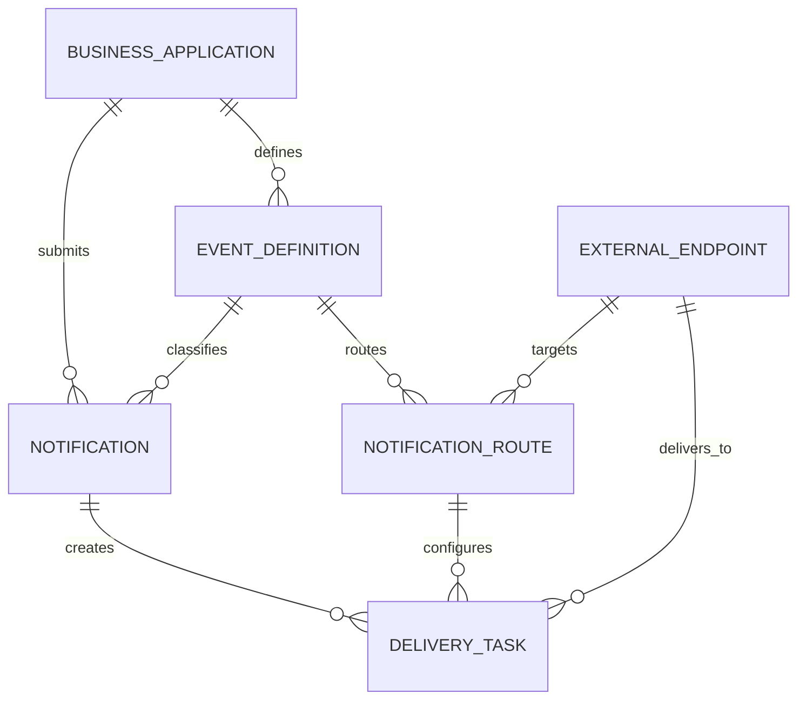

# API 通知服务开发方案（初版）

> 日期：2026-11-01
> 文档状态：初稿
> 范围：业务背景、整体架构与链路、表结构设计
> 关键技术决策：HTTP 接入、RocketMQ 事务消息、消费重试、死信队列

## 1. 业务背景

### 1.1 背景说明

企业内部存在多个业务系统。当注册、付款、购买等关键业务事件发生时，需要调用外部供应商提供的 HTTP(S) API 完成通知，例如：

- 用户通过第三方广告系统引流并注册成功后，通知对应的广告系统。
- 用户订阅付款成功后，通知 CRM 系统更新 Contact 状态。
- 用户购买商品后，通知库存系统变更库存。

不同外部供应商的 API 地址、HTTP Method、鉴权方式、Header 和 Body 格式各不相同。如果由每个内部业务系统分别实现外部 API 对接，会产生重复开发，并且重试、监控、密钥管理和故障处理方式难以统一。

因此需要建设一个内部 API 通知服务：内部业务系统只负责提交业务通知，通知服务负责将通知可靠地投递到目标外部 API。

### 1.2 核心问题

本服务主要解决以下问题：

1. **统一接入**：内部系统通过统一 HTTP API 提交通知。
2. **协议适配**：通过后台配置不同外部 API 的 URL、Header、Body 和鉴权信息。
3. **可靠接收**：通知服务确认接收后，任务不能静默丢失。
4. **异步投递**：内部业务请求不等待外部 API 完成。
5. **失败重试**：外部 API 暂时不可用时自动重试。
6. **流量缓冲**：突发任务先进入 RocketMQ，由消费者按自身容量处理。
7. **故障隔离**：外部系统响应缓慢时，不能无限占用应用线程。
8. **可查询性**：可以查询通知及投递任务的当前状态和最近一次错误。

### 1.3 初版范围

初版实现：

- 内部业务系统、事件、外部 API 和通知路由的后台配置。
- 统一 HTTP 通知接入接口。
- 请求幂等。
- RocketMQ 事务消息。
- Consumer 并发执行外部 HTTP 请求。
- RocketMQ 消费重试和死信队列。
- 通知状态和投递任务状态查询。
- 最近一次外部 HTTP 调用结果记录。

初版暂不实现：

- 完整的每次 HTTP 调用历史表。
- 一条事件同时投递大量外部目标的复杂编排。
- 自定义延迟重试调度中心。
- 多级审批、复杂后台权限和完整配置版本管理。
- 严格的全局有序或业务对象级有序投递。

为了保持事务消息和消费模型简单，初版约定：

> 一个内部通知请求匹配一条生效路由，生成一条投递任务和一条 RocketMQ 事务消息。

表结构仍采用 `notification` 与 `delivery_task` 分离的方式，为未来一条通知对应多条投递任务保留扩展空间。

### 1.4 可靠性语义

系统提供 `at-least-once` 投递语义：

- 已确认接收的任务不会静默丢失。
- 消费失败时由 RocketMQ 重新投递。
- 消费次数超过上限后进入死信队列。
- 极端情况下，外部 API 可能被重复调用。

典型重复窗口：

```text
外部 API 已经处理成功
        ↓
通知服务尚未更新任务状态时宕机
        ↓
RocketMQ 重新投递消息
        ↓
外部 API 被再次调用
```

如果外部 API 支持幂等键，应将 `delivery_task.id` 或业务幂等键传递给外部系统。

## 2. 整体架构与链路

### 2.1 总体架构

```mermaid
flowchart LR
    BIZ[内部业务系统] -->|HTTP 通知| API[通知接入服务]
    ADMIN[配置管理后台] --> CONFIG[(配置数据)]
    API -->|RocketMQ 事务消息| MQ[(RocketMQ)]
    API -->|本地事务| DB[(业务数据库)]
    MQ -->|正常消息 / 重试消息| CONSUMER[投递 Consumer]
    CONSUMER --> LIMITER[端点并发控制]
    LIMITER -->|HTTP(S)| EXT[外部 API]
    CONSUMER -->|更新任务结果| DB
    MQ -->|超过最大重试次数| DLQ[死信队列]
    DLQ --> DLQ_HANDLER[死信处理器]
    DLQ_HANDLER --> DB
```

### 2.2 组件职责

| 组件 | 职责 |
|---|---|
| 配置管理后台 | 管理业务系统、事件、外部 API 和通知路由 |
| 通知接入服务 | 鉴权、校验、幂等判断、发送事务消息、执行本地事务 |
| 业务数据库 | 保存配置、通知请求、投递任务及最近一次调用结果 |
| RocketMQ | 可靠分发、流量缓冲、消费重试和死信转移 |
| 投递 Consumer | 消费任务、控制并发、调用外部 API、更新任务状态 |
| 死信处理器 | 标记最终失败任务、记录原因并触发告警 |

### 2.3 RocketMQ 逻辑资源

初版只需要一组核心资源：

| 类型 | 建议名称 | 用途 |
|---|---|---|
| Transaction Topic | `notification-delivery` | 保存已经提交的投递任务消息 |
| Producer Group | `notification-tx-producer` | 发送事务消息并执行事务回查 |
| Consumer Group | `notification-delivery-worker` | 消费并执行外部 API 投递 |
| Retry | Consumer Group 对应的消费重试 | 暂时失败后重新投递 |
| DLQ | Consumer Group 对应的死信队列 | 超过最大重试次数后的最终处理 |

初版使用 RocketMQ 内建消费重试，不单独实现数据库重试调度器。重试策略按 Consumer Group 统一配置。未来如果不同外部 API 需要完全不同的重试时间，再引入自定义延迟消息或拆分 Consumer Group。

### 2.4 后台注册链路

后台配置顺序如下：

```text
注册内部业务系统
        ↓
生成调用凭证
        ↓
注册业务事件及 Payload Schema
        ↓
注册外部 API 地址和鉴权配置
        ↓
配置事件到外部 API 的通知路由
        ↓
配置超时和最大并发数，并为 Consumer Group 配置统一重试策略
        ↓
启用路由
```

#### 2.4.1 注册内部业务系统

配置内容：

- 系统编码和名称。
- Access Key 和 Secret。
- 启用或停用状态。

Secret 只在创建时返回一次，数据库保存哈希值，不保存可逆明文。

#### 2.4.2 注册事件

配置内容：

- 事件编码，例如 `subscription.payment_succeeded`。
- Payload JSON Schema。
- 启用或停用状态。

通知接入服务根据事件 Schema 校验请求中的业务数据。

#### 2.4.3 注册外部 API

配置内容：

- URL 或 URL 模板。
- HTTP Method。
- 鉴权类型和加密后的鉴权配置。
- 默认 Header。
- 请求超时时间。
- 成功和可重试状态码规则。
- 最大并发数。

#### 2.4.4 配置通知路由

路由将内部事件绑定到外部 API，并配置字段映射：

```text
支付系统 + subscription.payment_succeeded
                    ↓
CRM Update Contact API
                    ↓
Payload 字段映射到 URL / Header / Body
```

初版约束同一个事件只有一条 `ACTIVE` 路由。

### 2.5 内部请求接口

建议接口：

```http
POST /v1/notifications
Authorization: Bearer <application-token>
Idempotency-Key: payment-20261101-001
Content-Type: application/json
```

请求示例：

```json
{
  "eventType": "subscription.payment_succeeded",
  "data": {
    "paymentId": "P001",
    "contactId": "C001",
    "amount": 19900,
    "currency": "CNY"
  }
}
```

接收成功后返回：

```http
HTTP/1.1 202 Accepted
```

```json
{
  "notificationId": "N001",
  "status": "ACCEPTED"
}
```

`202 Accepted` 表示通知服务已经完成本地事务，并承担后续异步投递责任，不表示外部 API 已处理成功。

### 2.6 请求处理链路

#### 步骤 1：鉴权和校验

通知接入服务：

1. 根据调用凭证识别内部业务系统。
2. 检查业务系统是否启用。
3. 校验 `Idempotency-Key`、`eventType` 和 `data`。
4. 查找事件定义并使用 JSON Schema 校验 Payload。
5. 查找唯一生效的通知路由和外部端点。

#### 步骤 2：幂等判断

使用以下唯一约束保证请求幂等：

```text
UNIQUE(application_id, idempotency_key)
```

处理规则：

- 第一次提交：继续创建通知。
- 相同幂等键且 Payload 一致：返回原 `notificationId`。
- 相同幂等键但 Payload 不同：返回 `409 Conflict`。

#### 步骤 3：预生成标识

在发送事务消息前生成：

- `notificationId`
- `taskId`
- `traceId`

事务消息中只放任务定位信息，不放外部密钥：

```json
{
  "notificationId": "N001",
  "taskId": "T001",
  "traceId": "TRACE001"
}
```

#### 步骤 4：发送 RocketMQ 事务消息

事务链路：

```text
Producer 发送 Half Message
        ↓
Broker 保存不可见消息
        ↓
Producer 执行本地数据库事务
        ↓
INSERT notification
INSERT delivery_task
        ↓
本地事务成功：COMMIT Message
本地事务失败：ROLLBACK Message
```

本地事务包含：

```text
BEGIN
  INSERT notification
  INSERT delivery_task
COMMIT
```

如果 Broker 未收到明确的二阶段结果，会通过 Producer Group 发起事务回查。回查逻辑根据消息中的 `taskId` 查询数据库：

```text
任务存在且事务已经提交  -> COMMIT
任务不存在              -> ROLLBACK
数据库暂时不可用        -> UNKNOWN
```

事务消息保证的是本地任务状态与消息生产的最终一致性，不保证外部 API 调用成功。

#### 步骤 5：返回接收结果

- Half Message 发送失败且本地事务未执行：返回服务不可用错误。
- 本地事务回滚：返回失败。
- 本地事务提交成功：返回 `202 Accepted`。
- 客户端因网络问题重试：通过幂等键返回原通知结果。

### 2.7 消费和外部投递链路

Consumer 收到消息后执行：

```text
读取 taskId
    ↓
查询 delivery_task
    ↓
终态任务直接返回消费成功
    ↓
原子抢占任务并更新为 PROCESSING
    ↓
加载 notification、route、endpoint
    ↓
获取端点并发许可
    ↓
渲染 URL / Header / Body
    ↓
调用外部 HTTP API
    ↓
更新 delivery_task 和 notification
    ↓
返回消费成功或消费失败
```

#### 2.7.1 Consumer 线程模型

RocketMQ Consumer 的消费线程池负责并发执行任务。每个外部端点再配置独立的并发限制，例如：

```text
Consumer 总并发：100
CRM 最大并发：20
库存系统最大并发：30
广告系统最大并发：10
```

MQ 负责存放超过当前处理能力的任务，线程池只负责正在执行的任务。

Consumer 不能将任务提交给另一个线程池后立即返回消费成功。必须等待外部调用及数据库状态更新完成后，再向 RocketMQ 返回消费结果。

#### 2.7.2 原子抢占

Consumer 执行前通过条件更新抢占任务：

```sql
UPDATE delivery_task
SET status = 'PROCESSING',
    locked_by = :consumerInstance,
    lock_token = :lockToken,
    lock_until = :lockUntil,
    attempt_count = attempt_count + 1,
    first_attempt_at = COALESCE(first_attempt_at, CURRENT_TIMESTAMP),
    last_attempt_at = CURRENT_TIMESTAMP,
    updated_at = CURRENT_TIMESTAMP
WHERE id = :taskId
  AND status IN ('PENDING', 'RETRY_WAIT')
  AND (lock_until IS NULL OR lock_until < CURRENT_TIMESTAMP);
```

- 影响 1 行：当前 Consumer 获得执行权。
- 影响 0 行且任务为终态：直接返回消费成功。
- 影响 0 行且任务仍在其他实例处理中：本次不重复调用外部 API。

`lock_until` 应大于外部 HTTP 超时时间，并预留一定缓冲。

#### 2.7.3 外部响应分类

| 外部调用结果 | 任务处理 | RocketMQ 消费结果 |
|---|---|---|
| 成功状态码，默认 `2xx` | `SUCCEEDED` | 成功 |
| 网络异常、连接超时 | `RETRY_WAIT` | 失败，触发重试 |
| `408`、`429`、`5xx` | `RETRY_WAIT` | 失败，触发重试 |
| 不可重试的 `4xx` | `FAILED` | 成功，不再重试 |
| 任务已是 `SUCCEEDED/FAILED` | 不执行 HTTP | 成功 |

`attempt_count` 只在真正准备调用外部 HTTP API 时增加。RocketMQ 重复投递但没有实际调用外部 API，不计入 HTTP 尝试次数。

### 2.8 重试链路

初版使用 RocketMQ Consumer Group 的消费重试能力：

```text
外部 API 暂时失败
        ↓
更新 delivery_task = RETRY_WAIT
        ↓
Consumer 返回消费失败
        ↓
RocketMQ Retry
        ↓
消息重新投递给 Consumer
```

初版不单独建立业务重试表，也不实现数据库轮询调度。

最大消费重试次数由 Consumer Group 统一配置，不在单条路由中配置。`delivery_task.attempt_count` 只记录真实发生的外部 HTTP 调用次数，它不要求与 RocketMQ 的消息重投次数完全相等。

需要注意：重试机制用于处理小概率、暂时性的调用失败，不用于消费者限流。容量不足时应通过 Consumer 并发数、拉取批次和端点并发限制形成背压，而不是故意返回消费失败。

### 2.9 死信链路

消息超过最大消费重试次数后进入该 Consumer Group 对应的死信队列：

```text
超过最大重试次数
        ↓
RocketMQ DLQ
        ↓
死信处理器读取 taskId
        ↓
delivery_task = FAILED
last_error_type = MAX_RETRY_EXCEEDED
        ↓
notification = FAILED
        ↓
触发告警，等待人工处理
```

后台可以提供人工重试操作：

1. 将失败任务恢复为 `PENDING`。
2. 清理旧锁信息。
3. 重新发送一条普通投递消息。
4. 保留原有 `attempt_count` 和最近错误，便于排查。

### 2.10 状态设计

#### Notification 状态

```text
ACCEPTED -> PROCESSING -> SUCCEEDED
                       -> FAILED
```

#### Delivery Task 状态

```text
PENDING -> PROCESSING -> SUCCEEDED
                      -> RETRY_WAIT -> PROCESSING
                      -> FAILED
```

## 3. 表结构设计

### 3.1 表关系



初版共 6 张表：

1. `business_application`
2. `event_definition`
3. `external_endpoint`
4. `notification_route`
5. `notification`
6. `delivery_task`

不建立 `delivery_attempt` 表。每次 HTTP 调用的详细过程写入结构化日志，数据库只保存任务当前状态和最近一次调用结果。未来如果需要完整审计或外部 API SLA 分析，可以再增加投递尝试表。

### 3.2 `business_application`

记录接入通知服务的内部业务系统。

| 字段 | 建议类型 | 必填 | 说明 |
|---|---|---:|---|
| `id` | BIGINT / UUID | 是 | 主键 |
| `code` | VARCHAR(64) | 是 | 业务系统唯一编码 |
| `name` | VARCHAR(128) | 是 | 系统名称 |
| `access_key` | VARCHAR(128) | 是 | 调用凭证标识 |
| `secret_hash` | VARCHAR(255) | 是 | Secret 哈希 |
| `status` | VARCHAR(32) | 是 | `ACTIVE`、`DISABLED` |
| `created_at` | TIMESTAMP | 是 | 创建时间 |
| `updated_at` | TIMESTAMP | 是 | 更新时间 |

约束和索引：

```text
PRIMARY KEY(id)
UNIQUE(code)
UNIQUE(access_key)
INDEX(status)
```

### 3.3 `event_definition`

记录业务系统可以发送的事件类型和 Payload 结构。

| 字段 | 建议类型 | 必填 | 说明 |
|---|---|---:|---|
| `id` | BIGINT / UUID | 是 | 主键 |
| `application_id` | FK | 是 | 所属业务系统 |
| `event_code` | VARCHAR(128) | 是 | 例如 `order.paid` |
| `name` | VARCHAR(128) | 是 | 事件名称 |
| `payload_schema` | JSON | 是 | Payload JSON Schema |
| `status` | VARCHAR(32) | 是 | `ACTIVE`、`DISABLED` |
| `created_at` | TIMESTAMP | 是 | 创建时间 |
| `updated_at` | TIMESTAMP | 是 | 更新时间 |

约束和索引：

```text
PRIMARY KEY(id)
UNIQUE(application_id, event_code)
INDEX(application_id, status)
```

### 3.4 `external_endpoint`

记录一项具体的外部 HTTP API。

| 字段 | 建议类型 | 必填 | 说明 |
|---|---|---:|---|
| `id` | BIGINT / UUID | 是 | 主键 |
| `code` | VARCHAR(128) | 是 | 外部 API 唯一编码 |
| `name` | VARCHAR(128) | 是 | 外部 API 名称 |
| `http_method` | VARCHAR(16) | 是 | `POST`、`PUT`、`PATCH` 等 |
| `url_template` | VARCHAR(2048) | 是 | URL 或 URL 模板 |
| `auth_type` | VARCHAR(32) | 是 | `NONE`、`API_KEY`、`BEARER`、`BASIC` 等 |
| `auth_config` | TEXT | 否 | 加密后的鉴权配置或密钥引用 |
| `default_headers` | JSON | 否 | 不含明文密钥的默认 Header |
| `timeout_ms` | INT | 是 | HTTP 超时时间 |
| `max_concurrency` | INT | 是 | 端点最大并发数 |
| `success_rule` | JSON | 是 | 成功状态码规则，默认 `2xx` |
| `retryable_rule` | JSON | 是 | 可重试状态码规则 |
| `status` | VARCHAR(32) | 是 | `ACTIVE`、`DISABLED` |
| `created_at` | TIMESTAMP | 是 | 创建时间 |
| `updated_at` | TIMESTAMP | 是 | 更新时间 |

约束和索引：

```text
PRIMARY KEY(id)
UNIQUE(code)
INDEX(status)
```

安全要求：

- URL 仅允许 HTTP(S)。
- 应配置允许访问的域名范围，避免 SSRF。
- Token、API Key 等敏感信息不得以明文写入普通日志。

### 3.5 `notification_route`

记录内部事件到外部 API 的映射关系。

| 字段 | 建议类型 | 必填 | 说明 |
|---|---|---:|---|
| `id` | BIGINT / UUID | 是 | 主键 |
| `event_definition_id` | FK | 是 | 来源事件定义 |
| `external_endpoint_id` | FK | 是 | 目标外部 API |
| `request_mapping` | JSON | 是 | URL、Query、Header、Body 字段映射 |
| `status` | VARCHAR(32) | 是 | `ACTIVE`、`DISABLED` |
| `created_at` | TIMESTAMP | 是 | 创建时间 |
| `updated_at` | TIMESTAMP | 是 | 更新时间 |

约束和索引：

```text
PRIMARY KEY(id)
UNIQUE(event_definition_id, external_endpoint_id)
INDEX(event_definition_id, status)
```

初版业务约束：同一个 `event_definition_id` 最多只能有一条 `ACTIVE` 路由。该约束可以由应用逻辑保证。

### 3.6 `notification`

记录一次内部通知请求，主要承担请求幂等和原始 Payload 保存。

| 字段 | 建议类型 | 必填 | 说明 |
|---|---|---:|---|
| `id` | VARCHAR(64) / UUID | 是 | 对外通知 ID |
| `application_id` | FK | 是 | 来源业务系统 |
| `event_definition_id` | FK | 是 | 事件定义 |
| `idempotency_key` | VARCHAR(128) | 是 | 调用方幂等键 |
| `payload` | JSON | 是 | 原始业务数据 |
| `payload_hash` | VARCHAR(128) | 是 | 请求内容摘要 |
| `status` | VARCHAR(32) | 是 | `ACCEPTED`、`PROCESSING`、`SUCCEEDED`、`FAILED` |
| `mq_message_id` | VARCHAR(128) | 否 | RocketMQ 消息 ID |
| `trace_id` | VARCHAR(128) | 是 | 全链路追踪 ID |
| `accepted_at` | TIMESTAMP | 是 | 接收时间 |
| `finished_at` | TIMESTAMP | 否 | 完成时间 |
| `created_at` | TIMESTAMP | 是 | 创建时间 |
| `updated_at` | TIMESTAMP | 是 | 更新时间 |

约束和索引：

```text
PRIMARY KEY(id)
UNIQUE(application_id, idempotency_key)
INDEX(application_id, created_at)
INDEX(status, created_at)
INDEX(trace_id)
```

### 3.7 `delivery_task`

记录对外投递任务的当前状态、执行次数和最近一次 HTTP 调用结果。

| 字段 | 建议类型 | 必填 | 说明 |
|---|---|---:|---|
| `id` | VARCHAR(64) / UUID | 是 | 投递任务 ID |
| `notification_id` | FK | 是 | 所属通知 |
| `route_id` | FK | 是 | 使用的通知路由 |
| `endpoint_id` | FK | 是 | 目标外部 API |
| `status` | VARCHAR(32) | 是 | `PENDING`、`PROCESSING`、`RETRY_WAIT`、`SUCCEEDED`、`FAILED` |
| `attempt_count` | INT | 是 | 实际外部 HTTP 调用次数 |
| `locked_by` | VARCHAR(128) | 否 | 当前 Consumer 实例 |
| `lock_token` | VARCHAR(128) | 否 | 当前执行令牌 |
| `lock_until` | TIMESTAMP | 否 | 执行租约过期时间 |
| `first_attempt_at` | TIMESTAMP | 否 | 首次调用时间 |
| `last_attempt_at` | TIMESTAMP | 否 | 最近调用时间 |
| `last_http_status` | INT | 否 | 最近 HTTP 状态码 |
| `last_duration_ms` | BIGINT | 否 | 最近调用耗时 |
| `last_error_type` | VARCHAR(64) | 否 | 最近错误类型 |
| `last_error_message` | VARCHAR(1024) | 否 | 最近错误摘要 |
| `last_response_excerpt` | VARCHAR(2048) | 否 | 脱敏并截断的最近响应摘要 |
| `finished_at` | TIMESTAMP | 否 | 进入终态的时间 |
| `created_at` | TIMESTAMP | 是 | 创建时间 |
| `updated_at` | TIMESTAMP | 是 | 更新时间 |

约束和索引：

```text
PRIMARY KEY(id)
UNIQUE(notification_id, route_id)
INDEX(notification_id)
INDEX(status, updated_at)
INDEX(endpoint_id, status)
INDEX(lock_until)
```

### 3.8 结构化日志

由于初版不建立 `delivery_attempt` 表，每次外部 HTTP 调用必须写结构化日志，至少包含：

```text
notificationId
taskId
traceId
mqMessageId
attemptNo
endpointCode
httpStatus
durationMs
errorType
errorMessage
```

日志中的 Authorization、Cookie、Token、手机号、邮箱等敏感内容必须脱敏。

### 3.9 后续扩展

未来如果出现以下需求，可以新增 `delivery_attempt` 表，而不需要改变现有核心模型：

- 后台展示每一次 HTTP 请求和响应。
- 长期保存完整投递历史。
- 统计外部供应商 SLA。
- 对账、合规审计或争议处理。

未来允许一条通知投递多个外部目标时：

- 放开一事件一条生效路由的限制。
- 一条 `notification` 创建多条 `delivery_task`。
- 增加消息分发层，确保每条 Task 都有独立 MQ 消息和独立重试生命周期。

## 参考资料

- [Apache RocketMQ - Transaction Message](https://rocketmq.apache.org/docs/featureBehavior/04transactionmessage/)
- [Apache RocketMQ - Consumption Retry](https://rocketmq.apache.org/docs/featureBehavior/10consumerretrypolicy/)
